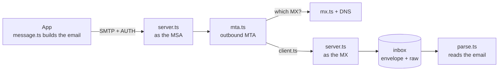

# mini-mta

[](https://github.com/<your-github-user>/mini-mta/actions/workflows/ci.yml)

A tiny mail transfer agent written from scratch in TypeScript: an SMTP server and client, a MIME builder and
parser, and MX-based delivery. No mail libraries and no internet, just `node:net`, `node:dns` and the RFCs.

I built it to understand what really happens between an email API answering `200 OK` and the message landing in
someone's inbox.

```
S: 550 5.1.1 <bia@acme.test>: mailbox unavailable
   ↳ "Nobody called bia@acme.test lives here." (5 = no, and trying again won't help; the 5.1.1 explains: "that address doesn't exist")
```

Every example prints the real protocol and, below the important lines, a plain-English explanation (`↳`).

## What's inside

- **SMTP server** ([RFC 5321](https://www.rfc-editor.org/rfc/rfc5321)) that plays two roles: an **MX** that receives
  mail for its own domains, and an **MSA** that requires `AUTH PLAIN` and relays anywhere. It handles multi-line
  replies, enhanced status codes, dot-stuffing, `SIZE`, greylisting and the null sender.
- **SMTP client** that returns a result instead of throwing: which stage failed, the reply code, and whether the
  failure is permanent (5xx) or temporary (4xx).
- **MIME** ([RFC 2045–2047](https://www.rfc-editor.org/rfc/rfc2045)): quoted-printable, base64, encoded-words,
  `multipart/alternative` with attachments, and a parser for the way back.
- **MX routing**: preference order, shuffled ties, implicit MX, null MX ([RFC 7505](https://www.rfc-editor.org/rfc/rfc7505))
  and NXDOMAIN, using Node's real `resolveMx` against a small DNS server over UDP.
- **Outbound MTA**: one SMTP transaction per domain, and a `delivered`, `deferred` or `bounced` outcome per recipient.
- **Interop**: [nodemailer](https://nodemailer.com) talks to the server and its messages go through the parser.
- **Benchmark**: SMTP versus an HTTP email API, in round trips, bytes and time.

## Architecture



The code is split in three layers that follow the path of an email: **mime** builds and reads the message,
**smtp** talks to servers, and **delivery** decides where the message goes. Each layer only depends on the one
below it: `mta.ts` uses `mx.ts` and `client.ts`, but never looks inside the message.

## Quick start

Requires Node.js 20 or newer.

```bash
npm install
npm test               # 51 tests
npm run conversation   # an SMTP conversation, line by line
```

## Examples

| Command | What you see |
|---|---|
| `npm run conversation` | The SMTP dialogue (`C:` / `S:`) and what ended up in the mailbox |
| `npm run send` | Envelope × header: the Bcc only exists on the envelope |
| `npm run compose` | The MIME message that a `POST /emails` turns into |
| `npm run read` | nodemailer sends, the server receives, the parser reads it back |
| `npm run routes` | MX preference, implicit MX, null MX and NXDOMAIN |
| `npm run delivery` | The whole path: app → MSA → MTA → MX → mailbox, with `Received` and `Return-Path` |
| `npm run bench` | SMTP (one connection per email, and a reused one) versus an HTTP API |

Set `EXPLAIN=0` to hide the `↳` explanations and get the raw output, like a real log.

## Project layout

```
src/
  smtp/        wire.ts (socket + multi-line replies), server.ts, client.ts
  mime/        encoding.ts, message.ts (build), parse.ts (read)
  delivery/    mx.ts (where to deliver), mta.ts (deliver and classify)
  testing/     fake DNS server, fake HTTP API, seeded random: used by tests and examples only
  index.ts     public API
examples/      one runnable script per concept, numbered in learning order
bench/         SMTP vs HTTP API
scripts/       environment check
```

Tests live next to the code they test (`server.ts` and `server.test.ts`).

## Design decisions

- **One server, two roles.** The MSA and the MX speak the same protocol; only the policy changes (require AUTH,
  accept other domains, write `Return-Path`). So it is one server with options, not two near-copies.
- **Dependencies come in as parameters.** The DNS resolver, the clock (`now`) and randomness (`random`) are
  injected. Real ones in production, fake and predictable ones here: no test depends on the network or on the time.
- **Rules separated from I/O.** Encoding, building and parsing messages and ordering MX records are plain
  functions; only the server, the wire and the fakes open sockets. The tricky logic is tested in milliseconds.
- **Results instead of exceptions.** `sendMail` and `deliver` return `{ ok, stage, code, permanent }`, in the
  spirit of an SDK's `{ data, error }`: the caller has to choose between retrying and giving up, and that is
  easier with a value than with `try/catch`.
- **Local and reproducible.** Servers listen on `127.0.0.1`, port 0, and domains end in `.test`. Nothing leaves the
  machine, tests never fight over a port, and the examples print the same output on every run.

## Limitations

This is a learning project, not a production mail server: no STARTTLS or TLS, no DKIM signing, no retry queue
(deferred recipients are reported, not retried) and no persistence. Each of these is a good next step.

## References

[RFC 5321](https://www.rfc-editor.org/rfc/rfc5321) (SMTP) ·
[RFC 5322](https://www.rfc-editor.org/rfc/rfc5322) (message format) ·
[RFC 2045](https://www.rfc-editor.org/rfc/rfc2045)–[2047](https://www.rfc-editor.org/rfc/rfc2047) (MIME) ·
[RFC 3463](https://www.rfc-editor.org/rfc/rfc3463) (enhanced status codes) ·
[RFC 7505](https://www.rfc-editor.org/rfc/rfc7505) (null MX)

## License

[MIT](LICENSE)
